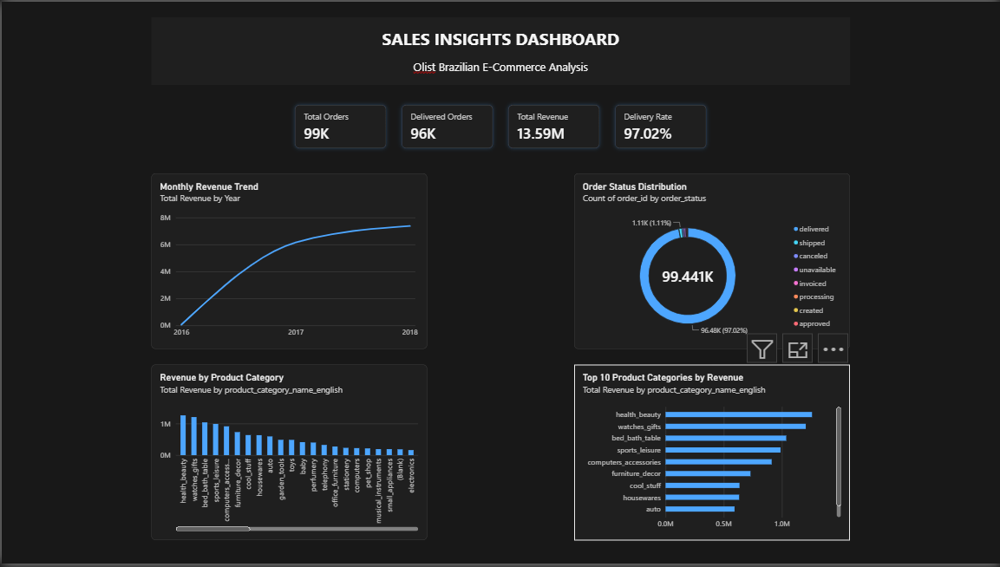
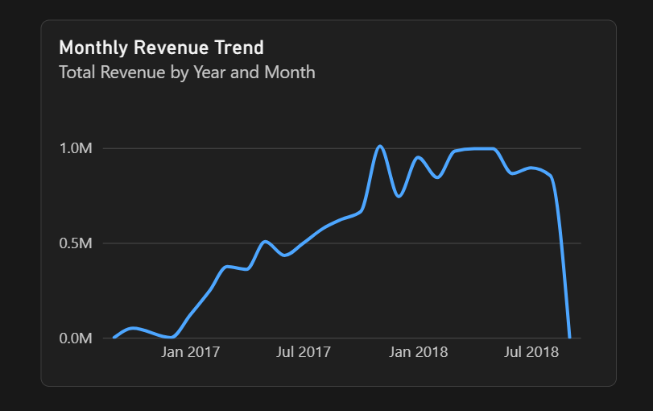
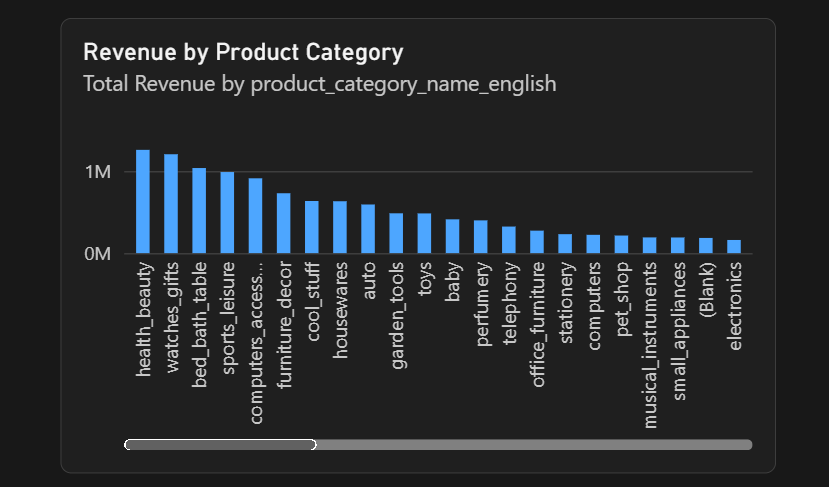

# Power BI Sales Insights Dashboard

## Project Overview

An interactive dashboard built in Microsoft Power BI Desktop using the Olist Brazilian E-Commerce dataset. It explores sales performance, revenue trends, product categories, and order fulfillment.

## Key Performance Indicators

* Total Orders: 99,441
* Delivered Orders: 96,478
* Total Product Revenue: 13,591,643.70
* Delivery Rate: 97.02%

*Revenue represents product prices and excludes freight charges.*

## Dashboard Features

* Monthly Revenue Trend
* Revenue by Product Category
* Order Status Distribution
* Top 10 Product Categories by Revenue
* Interactive visuals and filtering

## Tools and Technologies

* Microsoft Power BI Desktop
* Power Query
* DAX
* Data Modeling
* Data Visualization

## Skills Demonstrated

Data preparation, relationship modeling, measure creation, KPI development, business analysis, and dashboard design.

## Dataset

Olist Brazilian E-Commerce Public Dataset.

## Dashboard Screenshots

### Overview

### Revenue Trend

### Category Analysis

## Business Objective

To provide an accessible view of e-commerce sales performance and help users explore revenue patterns, category performance, and order fulfillment outcomes.
